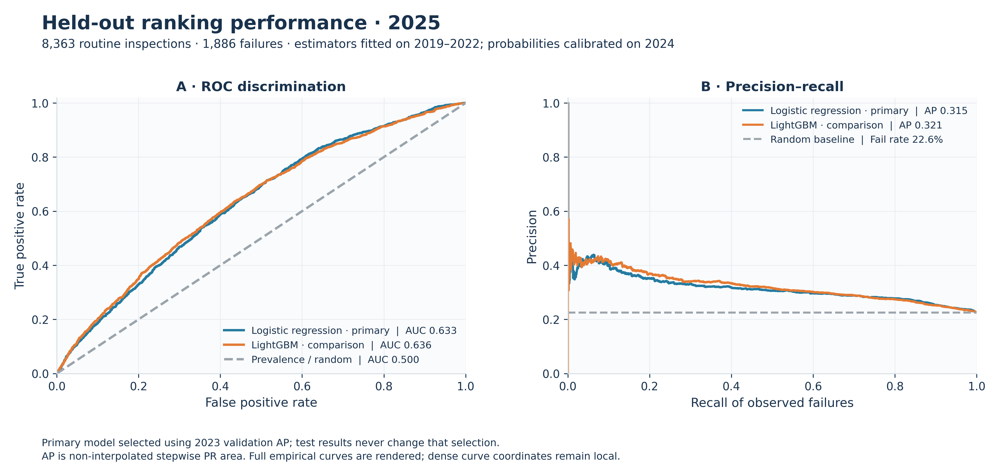
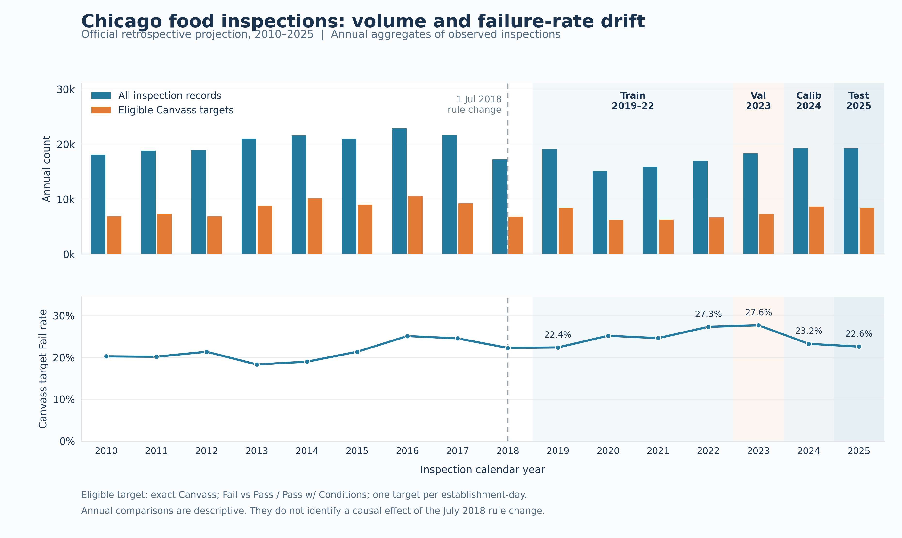
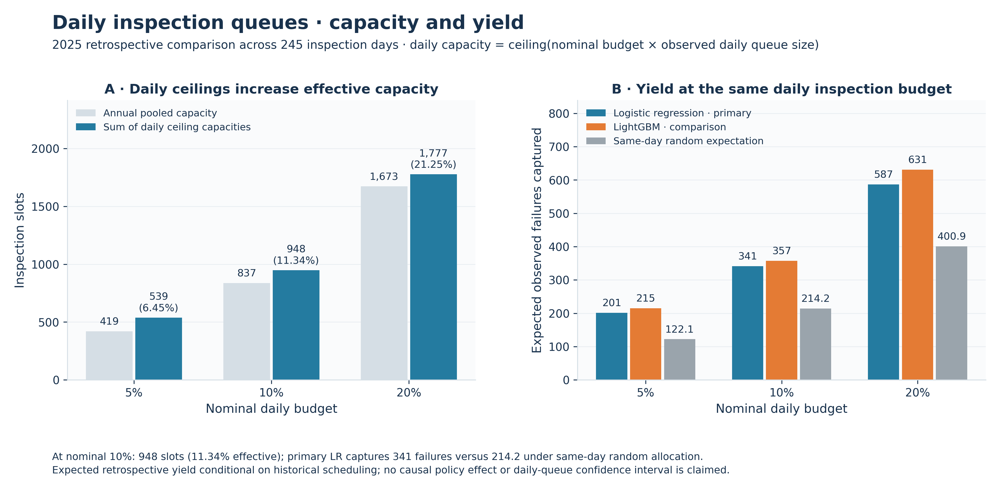
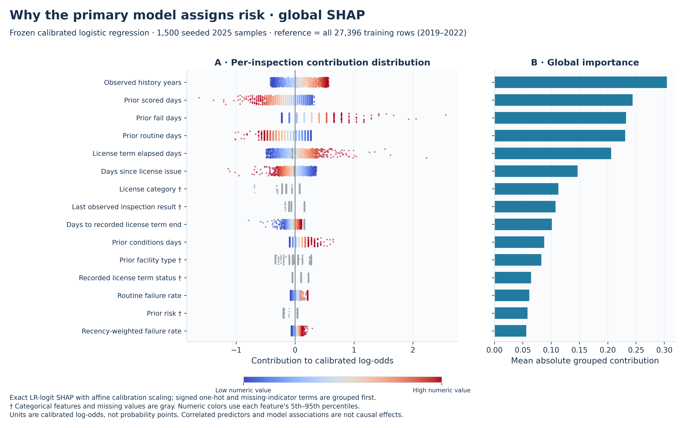

# Predicting Food Inspection Failures in Chicago

## Topic 1 · 全量分析、建模与交付报告

使用芝加哥官方检查与许可历史，预测商户在**指定日期接受 Canvass 例行检查时的 Fail 风险**。本研究已完成全量实验：2019–2022 年训练、2023 年选参／选模型、2024 年校准、2025 年最终测试。主模型是按 2023 年 AP 选定的校准 Logistic Regression（LR）。

**研究入口：** [深度分析报告](reports/topic1_report.md) · [模型完整对比与置信区间](reports/metrics/model_comparison.csv) · [十步保存记录](PROGRESS.md) · [最终 QA](reports/metrics/qa_summary.json)

## 1. 主要结果

2025 年测试集包含 **8,363 次合格检查、8,028 个实体、1,886 次 Fail**，Fail 率为 **22.55%**。下表均为 2024 年校准后的留出测试结果。

| 模型 | ROC-AUC | PR-AUC（AP） | Brier ↓ | LogLoss ↓ | 年度 Top10% Precision |
|---|---:|---:|---:|---:|---:|
| 校准基率 | 0.5000 | 0.2255 | 0.174706 | 0.533935 | 22.55% |
| **校准 LR：验证选定的主模型** | **0.6326** | **0.3146** | **0.168513** | **0.515382** | **36.20%** |
| 校准 LightGBM | 0.6357 | 0.3215 | 0.168129 | 0.514865 | 37.87% |

AP 使用非插值 Average Precision 定义。主模型 ROC-AUC 的 95% 实体聚类区间为 **[0.6197, 0.6470]**，AP 为 **[0.2968, 0.3352]**，Top10% Precision 为 **[32.91%, 39.75%]**；使用 500 次实体聚类 bootstrap，区间条件于已固定的拟合模型。

LightGBM 的 2025 年点估计略高，但其相对 LR 的 AP 差值为 **+0.006925，95% CI [−0.003442, +0.016447]**。2023 年验证 AP 则是 LR 0.378830、LightGBM 0.378063，因此继续保留 LR 为主模型，2025 年承担评估与解释职责。[模型选择](reports/metrics/model_selection.json) · [配对差值](reports/metrics/paired_model_differences.json)



概率尺度也有实质改进：LR 的 Brier 从 **0.169531 → 0.168513**；LightGBM 从 **0.220831 → 0.168129**，其平均预测概率从 **44.99% → 22.65%**，接近测试集实际的 22.55%。正斜率校准保持排序不变。[校准曲线](reports/figures/calibration_curves.png) · [校准汇总](reports/metrics/calibration_summary.json)

本轮覆盖仓库已有的基率、Logistic Regression 和 LightGBM。起始远端没有实现 XGBoost／CatBoost，本轮按既有实现完成全部模型对比。

## 2. 数据与固定时间设计

数据来自 [Chicago Food Inspections](https://data.cityofchicago.org/Health-Human-Services/Food-Inspections/4ijn-s7e5) 和 [Business Licenses](https://data.cityofchicago.org/Community-Economic-Development/Business-Licenses/r5kz-chrr)。本次快照取得于 **2026-11-19**，事件范围截至 **2025-12-31**。

- 检查源包含 **304,348 条记录**；许可查询覆盖 **1,185,058 条交易**，本地研究快照保留与检查许可号相关的 **201,981 条交易**。
- 目标仅为准确匹配 `Canvass` 的例行检查：`Fail=1`，`Pass` 和 `Pass w/ Conditions=0`。未知／未完成结果排除；投诉、复查等可提供历史信息，但不进入目标队列。
- 同实体同日冲突标签排除，同标签目标合并。2019–2025 年建模目标总计 **51,626**，历史特征可以利用 2010 年起的更早记录。
- 许可关联采用保守的许可号＋标准化地址规则；2025 年编号匹配率 **93.39%**，加地址后 **79.73%**，时点可见率 **79.55%**。[完整画像](reports/metrics/data_summary.json)

| 阶段 | 年份 | 合格目标数 | Fail 率 | 唯一职责 |
|---|---|---:|---:|---|
| Train | 2019–2022 | 27,396 | 24.68% | 拟合预处理器与模型 |
| Validation | 2023 | 7,277 | 27.64% | 选择预先规定的候选参数与模型 |
| Calibration | 2024 | 8,590 | 23.24% | 拟合正斜率 sigmoid 校准器 |
| Test | 2025 | 8,363 | 22.55% | 留出评估、解释与误判分析 |

2018 年前后规则与样本分布改变，因此 2010–2018 年只作为历史信息。2018 年上下半年目标 Fail 率为 **24.02% / 19.85%**；这一对比描述分布变化，不能把全部差异归因于规则本身。2023→2025 年基率也下降了 **5.08 个百分点**，解释跨年 AP 时需同时参考基率和 ROC-AUC。[年度聚合](reports/metrics/annual_drift.csv)



## 3. 对稽查资源调度意味着什么

主模型能够把更多 Fail 集中在有限优先名额内；较低分的商户仍需要常规覆盖。

| 回测操作点 | 实际名额 | 观察目标占比 | 捕获 Fail | 全部 Fail 捕获率 | 同容量随机 Lift |
|---|---:|---:|---:|---:|---:|
| 全年 pooled Top10% | 837 | 10.01% | 303 | 16.07% | 1.605 |
| 每日名义 Top10% | 948 | 11.34% | 341 | 18.08% | 1.592 |
| 每日名义 Top20% | 1,777 | 21.25% | 587 | 31.12% | 1.464 |

每日容量按 `ceil(比例 × 当天目标数)` 向上取整；其随机基准也在**同一天、同一容量**内计算。每日 Top10% 的 341 次命中，对应随机预期 **214.22 次**，优先名额内增加 **126.78 次（+59.18%）**。从每日 Top10% 扩至 Top20% 增加 829 个名额、覆盖额外 246 次 Fail，边际命中率 **29.67%**。[逐日容量与收益](reports/metrics/figure_daily_capacity_yield.csv)



这些是**条件于历史实际检查队列的回测收益**。模型在指定评分日期使用更早历史；本研究没有估计未知的下次检查日期，也没有观察当日所有未被检查的合资格商户。真实调度试点需要保存完整候选池、可用数据版本、人工调整和抽样概率，并保留常规覆盖及随机探索。提前发现天数、公共卫生效果和部署后的收益需另行验证。

## 4. SHAP 与误判的实测发现

主模型使用 **32 个数值特征＋7 个分类特征**。解析 LR-logit SHAP 以全部训练记录为参考，经校准仿射缩放后解释校准 log-odds；全局图显示固定抽样的 1,500 条测试目标。39 个原始字段的贡献可以重构全部测试预测，最大概率误差 **4.44×10⁻¹⁶**。[完整特征字典与解释方法](reports/topic1_report.md) · [SHAP 核验](reports/metrics/shap_summary.json)



- **历史暴露与失败证据共同决定分数。** 历史观察年限、已评分检查日数和失败日数是前三项贡献。相关特征的贡献会相抵；历史失败率的负条件系数不能解释为“失败具有保护作用”，许可可见年限也不等于真实开业年限。
- **历史 Pass 不能排除本次 Fail。** 全年 Top10% 下 TP／FP／FN／TN 为 **303／534／1,583／5,943**；FN 中 **68.86%** 最近一次历史结果是 Pass，冷启动仅 **0.57%**。FP 中 **34.83%** 本次为 Pass w/ Conditions，二分类标签将其归入 Non-Fail。
- **平均稳定不代表个体稳定。** 30 天历史滞后使 LR AP 从 **0.314566 → 0.313942**，Top10% 分配权重保留 **96.18%**，但单个风险分数最大变化 **12.55 个百分点**。

九个局部案例均为匿名工程摘要；极端案例用于说明分数形成，不能代表完整群体频率或确定现场成因。[FP 图](reports/figures/shap_local_fp.png) · [FN 图](reports/figures/shap_local_fn.png) · [TP 图](reports/figures/shap_local_tp.png) · [误判统计](reports/metrics/error_analysis.json) · [滞后结果](reports/metrics/lag_sensitivity.csv)

## 5. 防泄露验证与使用边界

默认检查历史只使用评分日之前至少 1 天的事件；当前结果、违规长文本、当前检查属性与标识字段均不进入模型。许可记录须不晚于历史截止日已发证、且在评分日已开始其记录期限；最终许可状态不会被倒填成过去的有效状态。所有模型预处理仅拟合训练期，2024 年专门校准，2025 年不用于选择模型。[冻结协议](reports/research_protocol.md) · [特征实现](src/chicago_food/features.py)

**实现层面的时间边界与历史公开时间是两件事。** 官方许可数据说明披露 2025-09-25 补充了部分 Address 字段；事后快照无法还原每个字段当时的公开版本。回归测试和 7／30 天滞后实验不能消除这一未知性。最终 QA 验证代码约束、数值和交付一致性，不把它扩展为对历史发布时间“绝对零泄露”的证明。

区间采用固定模型下的实体聚类 bootstrap，未覆盖重新训练、选参和校准的不确定性。子组覆盖差异和 SHAP 是描述性证据；[新增分组消融](reports/metrics/feature_ablation.csv)给出当前许可特征的条件预测增量，因果作用与未来调度效果仍需前瞻对照试验。

## 6. 一键复现

本次验证环境为 **CPython 3.12.14 / Linux x86_64**，完整依赖已固定在 [requirements-lock.txt](requirements-lock.txt)。首次准备：

```bash
git clone https://github.com/Li018/Predicting-Food-Inspection-Failures-in-Chicago.git
cd Predicting-Food-Inspection-Failures-in-Chicago
python3.12 -m venv .venv
source .venv/bin/activate
python -m pip install -r requirements-lock.txt
python -m pip install --no-deps -e .
```

本地已有本次冻结快照时，一条命令依次完成数据画像、三模型训练／校准、统一对比、全部图表、SHAP、误判、滞后敏感性和最终 QA：

```bash
python scripts/reproduce.py
```

新克隆缺少快照时，可让入口调用现有下载器：

```bash
python scripts/reproduce.py --download
```

下载使用本地临时目录，并先与 Git 中已提交的研究源哈希核对；只有一致的输入才能进入本次固定研究复现。**官方数据会被修正或回填，未来重新下载未必能得到本次快照。** 哈希不一致时入口明确停止，不覆盖研究清单或现有指标。精确复现需要保留本次本地快照；对新版本数据开展实验应使用单独的研究版本。

| 本地输入 | 冻结 SHA-256 |
|---|---|
| `data/snapshots/inspections.parquet` | `bc37fc88eb5d5dd199acba36bb310a0787fb70ad92699d498541648a636a1585` |
| `data/snapshots/licenses.parquet` | `049431f1501b11314f240afa530acab10c3e571af7c03d24d85744ca82654272` |

快照、模型、逐行特征／预测和运行日志保留在本地，分别位于 `data/snapshots/`、`.local/`，并受忽略规则保护。Git 仅发布轻量代码、源清单、汇总指标、PNG 与 Markdown。复现终端只显示阶段摘要，详细日志写入 `.local/logs/`。

```bash
# 本地已有冻结快照：只验证复现计划，不训练模型
python scripts/reproduce.py --dry-run

# 新克隆缺少数据：仅查看下载与分析计划，不实际下载
python scripts/reproduce.py --download --dry-run

# 单独运行完整回归测试
python -m pytest -q

# 核验交付物；测试证据失效时会重新运行 pytest
python scripts/qa_delivery.py
```

## 7. 验证与交付索引

冻结主研究的回归测试基线：**55 passed，1 warning**。增量分析的阶段测试数量见 [PROGRESS](PROGRESS.md)。唯一警告来自第三方测试插件对未来 pytest 10 的兼容性弃用提示。警告说明及当前数值、链接、图像、忽略规则和 Git 追踪核验结果见 [qa_summary.json](reports/metrics/qa_summary.json)。测试覆盖未来记录不改变过去特征、同日不可见、许可可见边界、未知结果处理、实体隔离、训练期预处理、校准单调性及容量同分策略等。[测试代码](tests/)

| 内容 | 入口 |
|---|---|
| 深度研究报告、39 特征字典、业务建议 | [reports/topic1_report.md](reports/topic1_report.md) |
| 数据画像、漂移、匹配与切分 | [data_summary.json](reports/metrics/data_summary.json) |
| 全模型 raw／calibrated 指标与置信区间 | [model_comparison.csv](reports/metrics/model_comparison.csv) |
| 全局与局部解释、校准、时间漂移、容量图 | [reports/figures/](reports/figures/)（11 张高清 PNG） |
| 错误群体、匿名案例和子组覆盖 | [error_group_summary.csv](reports/metrics/error_group_summary.csv) · [error_case_summary.csv](reports/metrics/error_case_summary.csv) · [error_subgroup_metrics.csv](reports/metrics/error_subgroup_metrics.csv) |
| 可见性延迟与相关贡献的解释边界 | [lag_sensitivity.json](reports/metrics/lag_sensitivity.json) · [feature_context.json](reports/metrics/feature_context.json) |
| 一键复现与最终检查 | [reproduce.py](scripts/reproduce.py) · [qa_delivery.py](scripts/qa_delivery.py) |
| 十步提交进度 | [PROGRESS.md](PROGRESS.md) |

## 8. 参考研究

- [Chicago/food-inspections-evaluation](https://github.com/Chicago/food-inspections-evaluation) 与[官方评估](https://chicago.github.io/food-inspections-evaluation/)：旧制度下的 critical violations 与历史排班模拟，是本项目的问题来源。其标签、时期及“提前发现”口径与本研究不同。
- Kannan, Shapiro & Bilgic (2019), [Hindsight Analysis of the Chicago Food Inspection Forecasting Model](https://arxiv.org/abs/1910.04906)：用于审视排班反事实假设、检查员差异及预测表现与公共卫生效果之间的距离。


## 9. 增量分析与两篇文献的实证对照

补充采用独立脚本，复用原冻结数据、主模型和解释结果；消融专用 LR 与原 39 字段主模型分别保留。完整方法、单位与表格见[报告第 14 节](reports/topic1_report.md#14-增量研究补充消融业务分组与文献对标)。

### 9.1 三组嵌套消融

<!-- supplemental-ablation-table -->
| 版本 | 原始字段数 | 2023 AP（raw） | 2025 AP（cal） | 相对前一消融 Δ AP | 2025 ROC-AUC（cal） | 2025 Brier（cal） |
|---|---:|---:|---:|---:|---:|---:|
| 仅历史结果 | 13 | 0.364596 | 0.310701 | — | 0.621743 | 0.169286 |
| ＋检查暴露与时间 | 27 | 0.375071 | 0.308815 | -0.001886 | 0.624677 | 0.169319 |
| ＋营业执照背景 | 37 | 0.375300 | 0.311790 | +0.002975 | 0.628029 | 0.168989 |
| 冻结主模型（单独参考） | 39 | 0.378830 | 0.314566 | — | 0.632637 | 0.168513 |
<!-- /supplemental-ablation-table -->

13→27→37 字段的三个版本均排除业态与风险等级，39 字段原模型单独作为参考。沿用 2019–2022 训练、2023 raw AP 选参、2024 独立校准、2025 测试；时间组提高测试 AUC 却降低 AP，许可组随后使 AP 增加 0.002975、Brier 减少 0.000330。这里是条件预测增量，未估计差值显著性。[完整消融与候选](reports/metrics/feature_ablation.json)

### 9.2 季节性、解释与业务切片

<!-- supplemental-seasonality-table -->
| 2019–2025 同制度样本 | 合格实体日数 | 最低月 Fail 率 | 最高月 Fail 率 | pooled 月度振幅 | 各年等权月度振幅 | 2023→2025 变化 |
|---|---:|---|---|---:|---:|---:|
| Canvass | 51,626 | 12 月／20.65% | 8 月／27.44% | 6.79 pp | 5.87 pp | -5.08 pp |
| Complaint | 10,817 | 12 月／33.16% | 8 月／41.10% | 7.94 pp | 7.67 pp | -2.93 pp |
<!-- /supplemental-seasonality-table -->

月序列基于 exact Canvass／Complaint 的明确结果与保守实体日去重。两组均有月度差异且 2023→2025 Fail 率下降，用于检查 2019 Finding 2 的时间不变性与 Finding 3 的对照趋势；Complaint 属于观察性对照，两篇旧制研究的 critical violations 也不等同本研究的 Fail。[年度／月度与分组摘要](reports/metrics/seasonality_complaint.json)

- **四组 SHAP：**沿用固定 1,500 条解释样本，历史失败／暴露时间／业态风险／许可背景的 mean abs grouped SHAP 分别为 **0.333／0.244／0.081／0.071**。先在样本内有符号相加，再取平均绝对值，保留局部闭合并显示相关项抵消；分组不等于消除了共线性。[分组证据](reports/metrics/grouped_shap_summary.json)
- **标准化 OR：**历史失败日数、历史观察年限和许可观察年限每增加 1 个训练 SD，对应校准后条件 odds 倍数为 **1.277／1.249／1.033**。与旧官方模型 Purple 聚类的 **4.74** 倍只比较信息依赖，不能跨标签、时期和单位比较效应强弱。本模型不包含检验员输入，但未证明历史标签或代理偏差消除。[OR 表与单位](reports/metrics/lr_odds_ratio_summary.json)
- **子群切片：**历史 Risk 1／2／3 的 AP 为 **0.320／0.294／0.266**，等宽 10 箱 ECE 为 **2.08／2.82／6.36 个百分点**；Risk 3 仅 **76 条／15 次 Fail**。全部切片共享年度 **837 槽位**的 Top10% 规则，主要业态和 Unknown 也保留在报告中。这是运营分配差异审计，不能据此认证人口公平性。[子组表](reports/metrics/subgroup_audit.csv)、[口径](reports/metrics/subgroup_audit_summary.json)
- **Days Earlier：**在 2025 六个固定双月窗口保留原每日日期槽，按每次 Fail 加权得到 **5.953 天**的回溯参考，包含所有负值和 **38.12%** 被延后的 Fail。现有分数在实际检查日生成，提前日期可能尚无输入；换日后标签也可能变化，因此不等于已实现的提前发现收益。[双月明细](reports/metrics/days_earlier_windows.csv)、[定义与局限](reports/metrics/days_earlier_summary.json)

### 9.3 与 CDPH 2015 和 Kannan 2019 的方法对照

| 维度 | CDPH／Schenk Jr. et al.（2015） | Kannan et al.（2019） | 本研究 Topic 1 |
|---|---|---|---|
| 角色与年代 | 官方预测项目，2011–2014 历史建模；2014 年 9–10 月评估 | 对旧官方模型及历史执法结果的独立审计 | 2019–2022 训练／2023 验证／2024 校准／2025 测试 |
| 标签与规则 | 2018-07-01 前旧制度的 critical violations | 检查旧制度标签、季节性与对照趋势 | 2018 规则变更后的 Canvass `Fail`；更早记录仅作历史 |
| 检验员相关偏差 | 模型包含检验员／聚类相关预测信息 | Finding 1 指出检验员聚类对预测与排班的影响 | 不使用检验员或聚类字段；未证明历史标签与代理偏差已消除 |
| 主要评估 | 固定两个月日期槽重排，计算 Days Earlier 等 | 系数、时间不变性、Canvass／Complaint 趋势审计 | AP／ROC-AUC／Brier、同日容量、历史风险与业态切片；另附双月重排参考 |
| 结论边界 | 历史队列模拟不等于因果公共卫生收益 | 审查排班假设，未替本研究验证部署效果 | 标签、时期、窗口不同；不以现代 AP 或 Days Earlier 宣称胜过旧项目 |

来源：[官方项目](https://github.com/Chicago/food-inspections-evaluation)、[官方重排函数](https://github.com/Chicago/food-inspections-evaluation/blob/master/CODE/functions/simulated_date_diff_mean.R)、[Kannan et al.（2019）](https://arxiv.org/abs/1910.04906)。

### 9.4 独立重算补充分析

需要原冻结快照及已生成的特征、主模型、预测和 SHAP 本地产物：

```bash
PYTHONPATH=src python scripts/analyze_ablation.py
PYTHONPATH=src python scripts/analyze_seasonality.py
PYTHONPATH=src python scripts/analyze_model_audit.py
python -m pytest -q
```

原 `scripts/reproduce.py` 及主模型拟合流程保持不变。新克隆即使不含本地逐行产物，仍可运行已发布汇总的一致性测试；精确重算继续要求原冻结快照，不能用新下载覆盖来源哈希。

本节补充阶段（2026-11-21，Commit 3）的完整测试为 **90 passed，1 warning**，包含原 55 项基线；该警告仍来自第三方 pytest 插件。后续演示文稿阶段的新增验证数量单独记录于 [PROGRESS](PROGRESS.md)。
