# Topic 1：芝加哥食品例行检查失败风险预测

## 研究结论与适用范围

本研究以官方检查与许可历史构建 39 个检查前可见特征，在 **2019–2022 年训练、2023 年选择模型、2024 年校准、2025 年测试**的固定时间协议下完成全量实验。主模型为 2023 年验证 AP 最优的 **Logistic Regression（LR）**，最终输出经独立年份校准的 Fail 风险概率。LightGBM 作为完整对照保留；其 2025 年点估计略高，但配对置信区间未排除差异为零，因此没有使用测试集重新选择模型。

核心结果如下，所有数值均来自本仓库实际运行后的汇总文件。

- **样本与覆盖**：2010–2025 年共 304,348 条检查记录，最终形成 2019–2025 年 51,626 个合格 Canvass 实体日目标；2025 年有 8,363 个目标、1,886 次 Fail，Fail 率 22.55%。
- **排序与概率**：主模型 2025 年 ROC-AUC 为 **0.6326**，AP 为 **0.3146**，Brier 为 **0.1685**，LogLoss 为 **0.5154**。排序有价值，但还不足以覆盖多数失败事件。
- **容量收益**：在历史逐日队列中，名义 Top10% 共分配 948 个槽位，捕获 341 次 Fail；同日同容量随机排序预期捕获 214.22 次，增加 **126.78 次，提升 59.18%**。由于逐日向上取整，实际选择比例是 **11.34%**。
- **许可信息的边界**：2025 年仅按许可号可匹配 93.39%，要求地址一致后为 79.73%，再要求历史时点可见后为 79.55%。主要缺口发生在保守实体关联阶段；不能靠放宽关联规则直接宣称提高数据质量。
- **解释与误判**：历史长度、检查次数、失败天数及许可期限特征相互关联。SHAP 能说明模型为何给出该分数，不能确定现场失败的真实原因。多数容量漏报仍有历史记录，问题并不主要由冷启动构成。
- **数据滞后**：把可见历史延迟扩大至 30 天，主模型 AP 从 0.314566 变为 0.313942，但最大单条概率变化达到 **12.55 个百分点**。聚合稳定与个体稳定必须分别评价。

证据：[数据画像](metrics/data_summary.json)、[统一模型对比](metrics/model_comparison.csv)、[模型选择记录](metrics/model_selection.json)、[逐日容量收益](metrics/figure_daily_capacity_yield.csv)、[滞后敏感性](metrics/lag_sensitivity.json)。

## 1. 预测问题：先固定标签、评分时点与使用场景

### 1.1 目标事件与二分类标签

目标仅包含 `Inspection Type == Canvass` 的例行检查；不把 Complaint、License、复查等类型混为目标。二分类标签是：

| 官方结果 | 本研究标签 | 解释 |
|---|---:|---|
| `Fail` | 1 | 本次例行检查未通过 |
| `Pass` | 0 | 本次例行检查通过 |
| `Pass w/ Conditions` | 0 | 按既定任务口径归入 Non-Fail；不代表没有问题 |
| 其他结果 | 不作为目标 | 不把未形成明确结果的检查当作通过 |

历史特征可使用此前其他检查类型的记录，以刻画已知检查历史；目标过滤与历史利用是两个不同操作。历史记录中的未知结果可以贡献“曾经发生检查”的信息，但不进入失败率的已评分分母。具体实现见 [features.py](../src/chicago_food/features.py)。

### 1.2 “下一次例行检查”的可操作定义

本研究估计的是：**在某商户于日期 t 接受例行检查这一条件下，根据 t 之前可见的历史，预测该次检查 Fail 的概率。** 每个目标的全部特征在其评分日期重新计算，默认历史截止到 `t - 1 天`。

这适合有明确评分日期、候选商户身份和地址的检查队列。当前回测使用实际发生检查的日期，**没有估计未知的下一次检查日期，也没有建立商户“什么时候会被检查”的生存模型**。月份特征与距上次检查间隔都依赖这个已知评分日期。部署入口 `score_candidates(..., as_of=...)` 可以在指定日期评分，但本次离线结果不能直接代表不同排班日期下的效果。

同一商户可能在不同年份再次出现，这是面向持续经营商户的时间预测设计，不是按商户完全隔离的冷启动评估。2025 年目标中，71.30% 的记录所属实体在训练期出现过；这没有允许使用该商户未来的结果，但限定了外推范围。[切分与实体覆盖证据](metrics/data_summary.json)

## 2. 全量数据、清洗与时间漂移

### 2.1 数据来源与“全量”的边界

检查数据来自 [Chicago Food Inspections，4ijn-s7e5](https://data.cityofchicago.org/Health-Human-Services/Food-Inspections/4ijn-s7e5)，许可来自 [Business Licenses，r5kz-chrr](https://data.cityofchicago.org/Community-Economic-Development/Business-Licenses/r5kz-chrr)。本次快照于 **2026-11-19 11:11:20 UTC** 完成，研究截止日固定为 2025-12-31。

| 数据对象 | 实际规模 | 保留范围及作用 |
|---|---:|---|
| 检查源记录 | 304,348 | 2010-01-01 至 2025-12-31，全量下载；按字段投影，不下载或建模 `Violations` 长文本 |
| 许可源查询记录 | 1,185,058 | 发证日期早于 2026-01-01 的查询范围，实际下载数与源端期望数一致 |
| 相关许可交易 | 201,981 | 仅保留检查数据涉及许可号的交易，不等于全市所有许可都进入建模快照 |
| 全时期合格目标 | 127,067 | 完成结果过滤、冲突剔除与同日折叠后的 Canvass 实体日 |
| 2019–2025 建模目标 | 51,626 | 四个时间分区；2019 年以前记录仍用于历史特征 |

两份 Parquet、原始下载、逐行特征、预测和拟合模型均保留本地并忽略；仓库交付轻量代码、汇总指标、PNG 和 Markdown。快照记录了来源与 SHA-256，重新下载可能因源端修订而变化，因此应将“相同代码可重跑”与“不同日期下载仍有完全相同数值”区分开。[来源、行数与校验依据](metrics/data_summary.json)；[下载脚本](../scripts/download_data.py)

### 2.2 实体关联与目标去重

实体优先使用 **规范化许可号＋规范化地址**；没有有效许可号时才使用 **规范化商户名＋地址**。地址缺失且不能可靠关联的记录保留独立身份。该策略避免同一连锁品牌不同门店混合，也避免同许可跨地址直接累积历史，但无法保证名称变化、迁址和历史地址修订全部得到正确处理。

同一实体同日缺少可靠的日内先后顺序，因此历史按“天”聚合。目标则先排除同日同时出现 Fail 与 Non-Fail 的冲突，再将同日同二分类标签折叠成一个目标。全时期共有 127,510 条有明确结果的 Canvass 记录；剔除 9 个冲突实体日涉及的 95 行，再折叠 348 行同日同标签记录，得到 127,067 个目标。这里的“同标签”是二分类标签，不要求 `Pass` 与 `Pass w/ Conditions` 的原始文本相同。[目标处理审计](metrics/data_summary.json)

清洗还识别到 813 条缺许可号、3 条缺地址的检查记录；许可中 158 条期限结束早于开始的记录，其结束日期被置为未知，没有据此构造负经营年限或违法状态。许可交易还存在 189 条缺少期限开始日的记录，无法通过当前可见性条件。[data.py](../src/chicago_food/data.py)、[清洗统计](metrics/data_summary.json)

### 2.3 固定时间切分

| 分区 | 日期范围 | 目标数 | 实体数 | Fail 数 | Fail 率 | 历史时点可见许可匹配率 | 冷启动率 |
|---|---|---:|---:|---:|---:|---:|---:|
| Train | 2019–2022 | 27,396 | 12,372 | 6,761 | 24.68% | 78.46% | 1.07% |
| Validation | 2023 | 7,277 | 7,206 | 2,011 | 27.64% | 78.48% | 1.51% |
| Calibration | 2024 | 8,590 | 8,320 | 1,996 | 23.24% | 79.65% | 0.73% |
| Test | 2025 | 8,363 | 8,028 | 1,886 | 22.55% | 79.55% | 0.53% |

实体数不能跨分区相加，因为同一实体可跨年份出现。冷启动表示此前没有可见检查日，不等价于“没有例行检查历史”或“没有许可历史”。[完整切分摘要](metrics/data_summary.json)

### 2.4 2018 规则变化与后续漂移

官方门户明确给出 **2018-07-01** 的检查程序与违规定义变化。下图同时展示检查量与合格 Canvass 失败率，避免把全部检查的分母与建模目标分母混用。[官方规则说明](https://data.cityofchicago.org/Health-Human-Services/Food-Inspections/4ijn-s7e5)

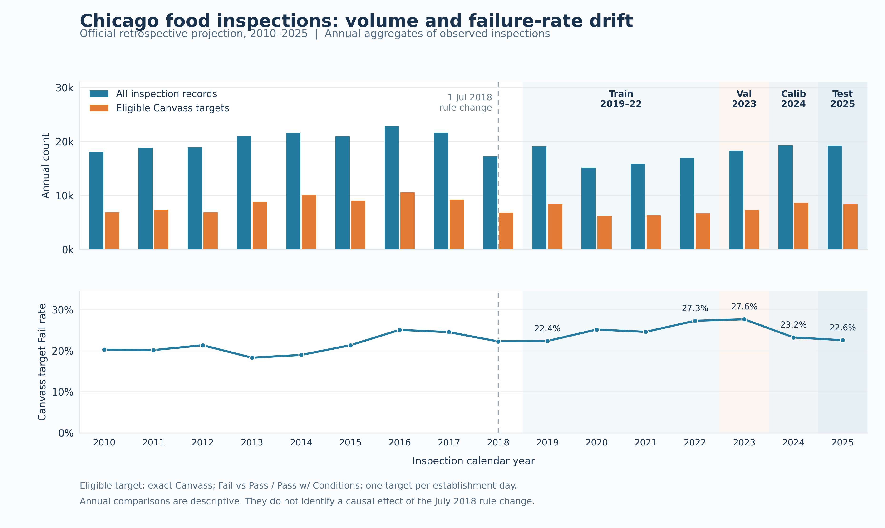

| 比较区间 | 合格目标数 | Fail 率 |
|---|---:|---:|
| 2018 年上半年 | 3,905 | 24.02% |
| 2018 年下半年 | 2,867 | 19.85% |
| 规则变更前相邻 12 个月：2017-07 至 2018-06 | 7,874 | 23.77% |
| 规则变更后相邻 12 个月：2018-07 至 2019-06 | 7,242 | 20.44% |

半年比较下降 4.17 个百分点；采用相邻完整 12 个月窗口后仍下降 3.34 个百分点。两种窗口都说明不宜把规则前后视作完全同分布数据，但这些是描述性差异，不能分离规则、执法执行、商户构成和时间环境的影响。本研究从 2019 年开始训练，保留更早历史并加入 `historical_pre2018_share`；这一字段没有完成新旧规则的等价转换。[规则前后聚合](metrics/data_summary.json)

后续漂移同样重要：2019→2020 年全部检查数从 19,052 降至 15,123，下降 20.62%；合格目标从 8,352 降至 6,166，下降 26.17%。2025 年合格目标数已接近 2019 年，但 2023→2025 年 Fail 率仍从 27.64% 降至 22.55%，下降 5.08 个百分点。这意味着检查量恢复并不等于标签基率恢复，验证期 AP 与测试期 AP 也不能脱离基率直接比较。上述数量变化本身不足以确定背后的成因。[年度聚合表](metrics/annual_drift.csv)

### 2.5 许可匹配：缺口主要在哪里

| 2025 年关联要求 | 匹配数／8,363 | 匹配率 | 相对上一层减少 |
|---|---:|---:|---:|
| 许可号在相关许可源中出现 | 7,810 | 93.39% | — |
| 许可号与规范地址均一致，暂不考虑时间 | 6,668 | 79.73% | 1,142 |
| 再要求发证与期限开始满足历史可见性 | 6,653 | 79.55% | 15 |

主要损失发生在加入地址约束时，而非最后的时间过滤。因此，后续数据治理应检查迁址记录、地址格式和门店身份，不能把 1,142 条差额直接称为“错误地址”，也不能为了匹配率而取消地址约束。全建模期 PIT 匹配率为 78.84%，不是仅在测试年出现的问题。[匹配分母与逐层定义](metrics/data_summary.json)

2025 年许可观测年限缺失 1,710 条，占 20.45%；距最近例行检查间隔缺失 995 条，占 11.90%；过去 365 天失败率缺失 3,275 条，占 39.16%。最后一项通常表示没有可见的近期已评分检查，不能填成“过去一年没有失败”。LR 使用训练期中位数和缺失指示列；LightGBM 使用其缺失处理机制。两者都保留缺失信号，没有把“无资料”写成“低风险”。[缺失率与预处理](metrics/data_summary.json)、[模型实现](../src/chicago_food/models.py)

## 3. 防泄露规则与不能由快照证明的事项

### 3.1 本次实现的事件时间边界

| 潜在泄露来源 | 当前规则 | 证据 |
|---|---|---|
| 当前检查结果、违规内容、当前商户属性 | 模型仅接受 39 个历史特征；当前结果只用于标签和误判描述 | [features.py](../src/chicago_food/features.py)、[models.py](../src/chicago_food/models.py) |
| 同日或未来检查 | 历史日期必须不晚于 `评分日 − lag`，默认 lag=1 | [历史特征实现](../src/chicago_food/features.py) |
| 同日多次记录的虚假先后 | 按实体日聚合，不用行顺序构造日内“上一次” | [特征回归用例](../tests/test_features.py) |
| 未来许可交易 | `date_issued ≤ 评分日−lag` 且 `term_start ≤ 评分日` | [许可特征实现](../src/chicago_food/features.py) |
| 当前许可最终状态回填历史 | 不把最终 `license_status` 作为历史特征；仅描述可见交易的记录期限 | [许可特征实现](../src/chicago_food/features.py) |
| 留出集参与预处理或选参 | 缺失处理、类别编码、估计器只在 2019–2022 年拟合；2023 年仅选择候选 | [运行脚本](../scripts/run_model.py) |
| 用测试标签选择模型或校准 | 2024 年独立校准；2025 年只评估与解释；主模型选择记录冻结 | [model_selection.json](metrics/model_selection.json) |

训练、预测及解释产物通过来源哈希和目标对齐检查连接起来；SHAP 重构与已保存概率也做了数值核对。已有回归测试覆盖未来记录不改变过去特征、同日不可见、实体隔离、未知结果处理、训练期预处理和测试标签不影响拟合等性质。**这些是本报告采用的实现约束与验证依据；完整 pytest 和最终链接／产物 QA 属于 Step 10，本报告不预先宣称该轮全量测试已经通过。**[特征测试](../tests/test_features.py)、[模型测试](../tests/test_models.py)

### 3.2 事件发生时间正确，不等于历史公开时间可复原

数据快照在 2026 年取得，记录的检查日与发证日不能证明对应字段当天已在公开门户可获取。官方还明确披露 **2025-09-25 为额外许可记录补充了 Address 字段**。因此，回测中一条很早发证的交易可能使用了后来补齐的地址；仅检查 `date_issued` 无法排除此类回填影响。[Business Licenses 官方说明](https://data.cityofchicago.org/Community-Economic-Development/Business-Licenses/r5kz-chrr)

本研究可以支持“代码遵守明确的事件时间过滤”这一结论，不能证明“所有字段在历史评分日都已经发布”。7／30 天滞后实验只能测量延迟可见事件的敏感性，不能还原缺失的历史发布版本。真正的在线验证需要从部署开始保存每日可见快照、字段更新时间和评分日志。

此外，检查历史最早到 2010 年，许可库也存在覆盖边界和商户关联限制。`observed_history_years` 是距最早可见检查的年数，`license_observed_tenure_years` 是距最早可见许可期限开始日的年数，二者都不是经核实的开业年限。迁址、换证或此前未观察到的经营期会改变这两个代理量。

## 4. 完整特征字典：32 个数值特征＋7 个分类特征

以下定义对应 [FEATURE_COLUMNS](../src/chicago_food/features.py)。所有“历史”均指满足当前评分日可见性条件的记录；历史以**不同检查日**计数，而非原始事件行数。一个已评分日只要存在 Fail，就记为失败日；同日也可能同时有条件通过，因此失败天数与条件通过天数不是互斥分类。

“最新可见许可交易”指可见交易按 `(term_start, date_issued, license_id)` 排序后的最后一条；`days_since_license_issue` 则单独使用可见发证日期的最大值。

### 4.1 数值特征

| # | 字段 | 精确定义／单位 |
|---:|---|---|
| 1 | `prior_inspection_days` | 所有类型的历史检查日数，含未形成明确结果的日子 |
| 2 | `prior_scored_days` | 至少有一个 Fail／Pass／Pass w/ Conditions 的历史日数 |
| 3 | `prior_fail_days` | 至少出现一个 Fail 的历史日数 |
| 4 | `prior_conditions_days` | 至少出现一个 Pass w/ Conditions 的历史日数 |
| 5 | `historical_failure_rate` | 失败日数／已评分日数；无已评分历史则缺失 |
| 6 | `historical_conditions_rate` | 条件通过日数／已评分日数；无已评分历史则缺失 |
| 7 | `prior_routine_days` | 至少有一个明确结果的 Canvass 历史日数 |
| 8 | `routine_failure_rate` | 历史 Canvass 失败日数／合格 Canvass 日数 |
| 9 | `last3_failure_rate` | 最近最多 3 个已评分日的失败日比例 |
| 10 | `last5_failure_rate` | 最近最多 5 个已评分日的失败日比例 |
| 11 | `recency_weighted_failure_rate` | 已评分日失败比例的时间衰减加权均值，半衰期 365.25 天 |
| 12 | `scored_days_365d` | 日期不早于评分日−365 天的可见已评分日数 |
| 13 | `failures_365d` | 同一 365 天窗口内的失败日数 |
| 14 | `failure_rate_365d` | 同一窗口的失败日比例；窗口内无已评分日则缺失 |
| 15 | `days_since_last_inspection` | 距最近可见检查日的天数，检查类型不限 |
| 16 | `days_since_last_scored_inspection` | 距最近可见已评分检查日的天数 |
| 17 | `days_since_last_routine` | 距最近有明确结果的可见 Canvass 日的天数 |
| 18 | `days_since_last_failure` | 距最近可见失败日的天数；从无可见 Fail 则缺失 |
| 19 | `observed_history_years` | 评分日距最早可见检查日的天数／365.25 |
| 20 | `cold_start` | 没有任何可见历史检查日为 1，否则为 0 |
| 21 | `no_scored_history` | 没有可见已评分历史日为 1，否则为 0 |
| 22 | `recent_failure_streak` | 从最近已评分日向前连续失败的日数；跳过未评分日 |
| 23 | `historical_pre2018_share` | 可见全部检查日中早于 2018-07-01 的比例 |
| 24 | `license_history_available` | 许可号＋地址至少存在一条满足历史可见条件的交易为 1 |
| 25 | `license_observed_tenure_years` | 评分日距可见交易中最早期限开始日的天数／365.25 |
| 26 | `days_since_license_issue` | 评分日距可见交易中最近发证日的天数 |
| 27 | `license_records_observed` | 当前实体可见许可交易条数 |
| 28 | `license_terms_observed` | 可见交易中不同 `(term_start, term_end)` 组合数 |
| 29 | `days_to_license_term_end` | 最新可见交易的期限结束日减评分日；可为负；结束未知则缺失 |
| 30 | `license_term_elapsed_days` | 评分日距最新可见交易期限开始日的天数 |
| 31 | `month_sin` | `sin(2π×(评分月份−1)/12)` |
| 32 | `month_cos` | `cos(2π×(评分月份−1)/12)` |

### 4.2 分类特征

| # | 字段 | 精确定义／缺失语义 |
|---:|---|---|
| 33 | `last_result` | 最近历史检查日的明确结果；多个不同明确结果为 `Mixed`，无明确结果为 `Unknown` |
| 34 | `last_routine_result` | 最近合格 Canvass 历史日的结果；同日多个不同明确结果为 `Mixed` |
| 35 | `prior_facility_type` | 最近历史检查日记录的场所类型；同日多个不同值为 `Ambiguous`，没有值为 `Unknown` |
| 36 | `prior_risk` | 最近历史检查日记录的风险等级，采用相同歧义／未知处理 |
| 37 | `license_term_status` | `No history`／`End unknown`／`In recorded term`／`Recorded term expired`；仅记录期限状态 |
| 38 | `license_category` | 最新可见许可交易的许可描述；无可见交易或值为 NaN 时为 `Unknown`，空字符串保留 |
| 39 | `license_application_type` | 最新可见许可交易的申请类型；无可见交易或值为 NaN 时为 `Unknown`，空字符串保留 |

无历史时，计数与连续失败长度为 0，失败率和间隔保持缺失，辅以显式指示列。没有许可历史时，交易数／期限数为 0，许可年限与间隔保持缺失。`Recorded term expired` **不等于违法经营、吊销或没有有效许可**；当前快照中的最终法律状态未被当成历史时点已知信息。

## 5. 模型、选择与评估方法

### 5.1 复用现有实现，逐阶段固定训练职责

仓库原有模型包括常数基率、LR 和 LightGBM。本次未新增 XGBoost／CatBoost，因为最新远端并未实现这两类模型，收尾范围遵循“按已实现模型运行”。逐模型运行脚本复用现有预处理、估计器、校准与指标模块，没有重新实现一套核心模型。

| 模型 | 训练方式 | 2023 年选择结果 |
|---|---|---|
| Prevalence | 对所有商户输出训练期 Fail 率，作为无排序信息基准 | 无超参数 |
| LR | 训练期中位数填补＋缺失指示、数值标准化、OneHot；4 组候选 | `C=0.1`，`class_weight=None` |
| LightGBM | 数值缺失原生处理；训练期 Ordinal 编码并明确声明原生分类列；6 组候选 | 15 leaves，400 trees，learning rate 0.04，min child 80，L2 10，balanced class weights |

2023 年 AP：LR **0.378830**，LightGBM **0.378063**，基率 **0.276350**。主模型按该结果固定为 LR，之后没有把训练集与验证集合并重训。每个模型都使用同一套 2024 年正斜率 sigmoid 校准方法以支持公平比较，但校准后 2024 年指标属于校准拟合期诊断，2025 年才是校准后的留出评估。[候选选择详情](metrics/logistic_regression_validation.csv)、[LightGBM 候选](metrics/lightgbm_validation.csv)、[固定模型记录](metrics/model_selection.json)

### 5.2 指标定义与置信区间

- **ROC-AUC** 衡量 Fail 相对 Non-Fail 的排序能力；**PR-AUC 在本仓库明确采用 non-interpolated AP**，不是把绘出的 PR 折线作梯形积分。AP 的无信息基准随样本 Fail 率变化。
- **Brier／LogLoss** 检验概率质量，越低越好；排序更好不保证概率已校准。
- **Precision@Top-K** 是分配槽位中的 Fail 比例；**Recall@Top-K** 是全部 Fail 中被优先覆盖的比例；**Lift** 为该 Precision 相对对应随机基准的倍数。
- 年度 Top-K 的容量为 `ceil(f×N)`；边界同分平均分配剩余槽位，报告随机打破同分的期望命中。逐日版本每天独立向上取整，必须同时报告实际容量比例。
- 95% CI 使用 **500 次实体聚类百分位 bootstrap**：按实体有放回抽样，保留其全部检查记录，每次重新计算指标分母与容量。模型保持固定，区间不包括重训练、选参、校准拟合、发布滞后或时间漂移的不确定性；现有 CI 适用于年度 pooled 指标，不能贴到逐日容量结果上。

实现与定义：[metrics.py](../src/chicago_food/metrics.py)、[统一对比表](metrics/model_comparison.csv)。

## 6. 模型对比：有限但可量化的优先排序能力

### 6.1 2025 年校准模型结果

| 模型 | ROC-AUC［95% CI］ | AP［95% CI］ | Brier | LogLoss | 年度 Top10% Precision［95% CI］ |
|---|---|---|---:|---:|---|
| 校准基率 | 0.5000［0.5000, 0.5000］ | 0.2255［0.2170, 0.2344］ | 0.174706 | 0.533935 | 22.55%［21.70%, 23.44%］ |
| **校准 LR（主模型）** | **0.6326［0.6197, 0.6470］** | **0.3146［0.2968, 0.3352］** | **0.168513** | **0.515382** | **36.20%［32.91%, 39.75%］** |
| 校准 LightGBM | 0.6357［0.6217, 0.6490］ | 0.3215［0.3027, 0.3430］ | 0.168129 | 0.514865 | 37.87%［34.57%, 41.01%］ |

主模型 Brier 的 95% CI 为 [0.164102, 0.173236]，LogLoss 为 [0.505311, 0.526228]。相较常数基率，LR 将高风险样本集中到队列前部，同时改善概率损失；但 AUC 约 0.63 说明大量 Fail 与 Non-Fail 仍存在分数重叠，不能称为已实现高精度现场诊断。[完整指标及区间](metrics/model_comparison.csv)、[LR 区间明细](metrics/logistic_regression_confidence_intervals.csv)

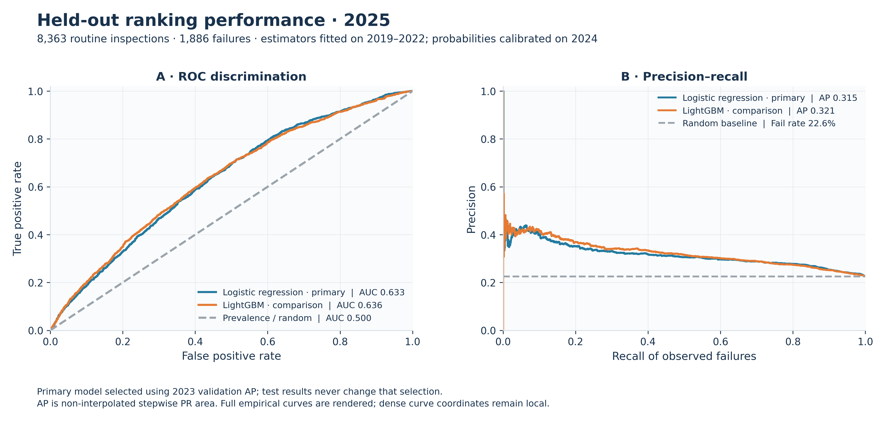

### 6.2 为什么不根据 2025 年改选 LightGBM

以同一次实体重采样配对比较两种校准模型，LightGBM−LR 的 AP 差值为 **+0.006925**，95% CI **[−0.003442, +0.016447]**；AUC 差值 **+0.003093**，CI **[−0.005119, +0.010748]**；年度 Top10% Precision 差值 **+1.67 个百分点**，CI **[−1.07, +4.37] 个百分点**。Brier 和 LogLoss 的差值区间也包含零。

这支持“2025 点估计略占优，但现有固定模型 bootstrap 未排除无差异”，不支持“LightGBM 已显著胜出”。区间跨零也不是两模型等价的证明；本次没有做多重比较校正或等效性检验。继续使用 2023 年选择的 LR，保持测试集只承担最终评估职责。[配对差值与局限](metrics/paired_model_differences.json)

### 6.3 训练、验证与基率的联合解读

| 模型 | Train AUC | Validation AUC | Train AP | Validation AP |
|---|---:|---:|---:|---:|
| LR | 0.637943 | 0.615971 | 0.359202 | 0.378830 |
| LightGBM | 0.741987 | 0.615244 | 0.496331 | 0.378063 |

LR 的验证 AP 高于训练 AP，但验证 AUC 更低；同时 Fail 基率由 24.68% 升至 27.64%。因此不能仅凭 AP 上升说模型在新年份更强。LightGBM 的训练与验证差距明显更大，说明其训练期拟合优势没有完整转移到 2023 年；该差距同时可能包含训练内乐观性与时间分布变化，不能仅凭这一张表全部归因于过拟合。[LR 分期指标](metrics/logistic_regression_metrics.json)、[LightGBM 分期指标](metrics/lightgbm_metrics.json)

从验证年到测试年，LR 的 AP 由 0.378830 降至 0.314566，AUC 却由 0.615971 升至 0.632637，同时 Fail 基率从 27.64% 降至 22.55%；作为描述性参照，AP／基率约为 1.371→1.395。这说明不能把跨年的 AP 下降直接称为排序退化；该比值也不是经过基率标准化的因果比较或新的选模指标。[同一模型的分期评估](metrics/logistic_regression_metrics.json)

### 6.4 年度 pooled 容量回测

| 主模型年度容量 | 实际槽位 | 命中 Fail | Precision | Recall | 相对全局随机 Lift |
|---|---:|---:|---:|---:|---:|
| Top5% | 419 | 170 | 40.57% | 9.01% | 1.799 |
| Top10% | 837 | 303 | 36.20% | 16.07% | 1.605 |
| Top20% | 1,673 | 553 | 33.05% | 29.32% | 1.466 |

主模型年度 Top10% Recall 的 95% CI 为 [14.72%, 17.49%]，Lift 为 [1.471, 1.748]。容量增加时 Precision 下降、Recall 上升，表明业务选择应基于覆盖与命中之间的权衡。年度 pooled 排序是静态回溯分析：各分数在各自检查日生成，不能把全年已知记录假装成同一天就可获得的候选池。[容量指标](metrics/figure_topk_performance.csv)

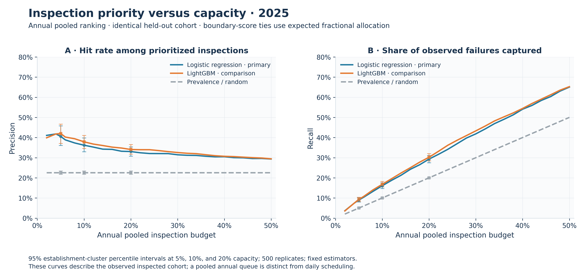

## 7. 校准：保持排序，修正概率尺度

独立校准函数为 `p_cal = sigmoid(a×logit(clip(p_raw)) + b)`，其中斜率 a 约束为正。LR 的 a=0.763852、b=−0.348949；LightGBM 的 a=0.656902、b=−1.123554。所有参数只由 2024 年数据拟合。

| 模型 | 2025 平均概率：原始→校准 | Brier：原始→校准 | LogLoss：原始→校准 | 分箱 ECE：原始→校准 |
|---|---|---|---|---|
| LR | 24.70%→22.99% | 0.169531→0.168513 | 0.517131→0.515382 | 2.61→2.10 个百分点 |
| LightGBM | 44.99%→22.65% | 0.220831→0.168129 | 0.631613→0.514865 | 22.44→1.82 个百分点 |

2025 实际 Fail 率为 22.55%。LR 校准后的均值偏差由 +2.15 缩小到 +0.44 个百分点；LightGBM 由 +22.44 缩小到 +0.10 个百分点。后者使用 balanced 类别权重，原始模型分数明显不适合直接当作自然样本分布下的 Fail 概率；独立校准对其尤为重要。这一结果不表示校准消除了全部偏差，或者在下一个年份必然仍然有效。[校准统计](metrics/calibration_summary.json)

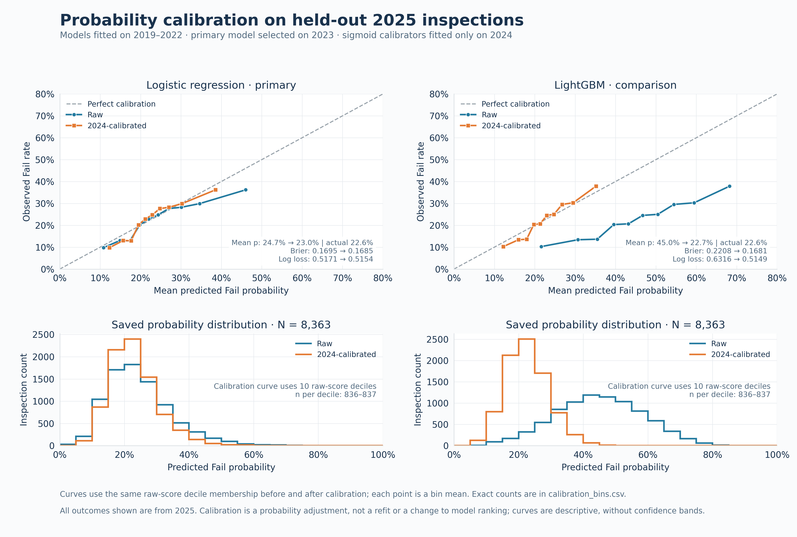

图中使用每个模型 2025 年原始分数的十等频箱，原始与校准结果保持同一批箱内样本。ECE 是依赖分箱选择的描述统计，未用于选择模型或校准器，图中也未估计箱内置信区间。单调校准没有改变本次 AUC、AP 或 Top-K 排序；它改善的是分数的概率含义。[校准分箱数据](metrics/calibration_bins.csv)

## 8. SHAP：解释条件评分，不把相关性当成经营因果

### 8.1 解释方法与数值闭合

解释对象是固定的主模型 LR。其 39 个原始特征经预处理形成 100 个列，包括数值变换、17 个缺失指示和 OneHot。参考分布使用**全部 27,396 条训练记录**的变换后均值，不进行默认背景子采样。

对原始 LR logit，逐列解析贡献为 `φ_j = β_j×(z_j−E_train[z_j])`，基值为 `β₀+β·E_train[z]`；同一原始字段的编码列先按符号相加，再求平均绝对重要性。校准后在未触发 clip 的观察输入上，使用 `φ_cal=aφ`、`base_cal=a×base+b`，最后以 sigmoid 恢复概率。

解析贡献与 `shap.LinearExplainer` 完全一致；8,363 条测试记录均没有触发校准 clip，最大概率重构误差为 **4.44×10⁻¹⁶**。这验证了观察样本上的贡献闭合。解释精确性限定为 **LR-logit SHAP 与仿射校准缩放**，不声称截断校准函数在整个可能输入空间都线性。[解释方法与核验](metrics/shap_summary.json)、[解释脚本](../scripts/explain_model.py)

所有 SHAP 数值的单位是**校准后的 log-odds**，不是概率百分点。基值为 −1.247155；对它取 sigmoid 得到的参考分数，不等于训练或测试集的平均预测概率。全局图仅使用固定种子抽取的 1,500 个不重复测试样本；这一步用于解释，没有重新选特征或拟合模型。

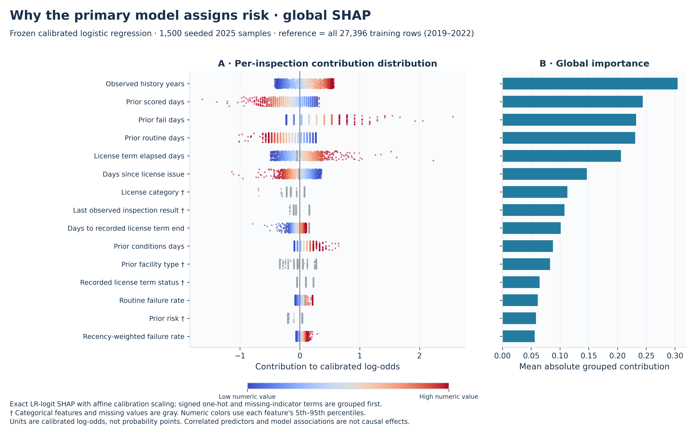

### 8.2 主导信号及其条件含义

| 排名 | 原始特征 | 平均绝对 grouped SHAP | 已观察数值的条件方向 |
|---:|---|---:|---|
| 1 | `observed_history_years` | 0.3046 | 正 |
| 2 | `prior_scored_days` | 0.2439 | 负 |
| 3 | `prior_fail_days` | 0.2323 | 正 |
| 4 | `prior_routine_days` | 0.2308 | 负 |
| 5 | `license_term_elapsed_days` | 0.2059 | 正 |
| 6 | `days_since_license_issue` | 0.1467 | 负 |
| 7 | `license_category` | 0.1129 | 按类别分别贡献，不存在连续高低方向 |
| 8 | `last_result` | 0.1079 | 按类别分别贡献 |

模型组合使用“观察多久、检查多少次、失败多少次”，并非只依据一次失败结果。这里的方向是同时保留其他模型输入时的拟合方向。历史长度排第一，不能推出“经营越久越危险”；检查次数为负，也不能直接推出“增加检查次数会改善安全”。这些字段共同描述观察历史与执法接触过程。[全局归因与系数](metrics/shap_global_importance.csv)

用户关注的三个字段也有值得区分的结果：`historical_failure_rate` 排第 27，条件斜率为 −0.19398／单位比例；`days_since_last_inspection` 排第 22，条件斜率约 +0.000164／天；`license_observed_tenure_years` 排第 18，条件斜率约 +0.005821／年。失败率的负系数**不表示失败经历具有保护作用**：模型同时包含失败天数、已评分天数、近期失败率与其他相关历史项，不能把其中一个条件系数当成边际关系或干预效果。许可年限同样是观测代理量，不能据此评价真实企业成熟度。

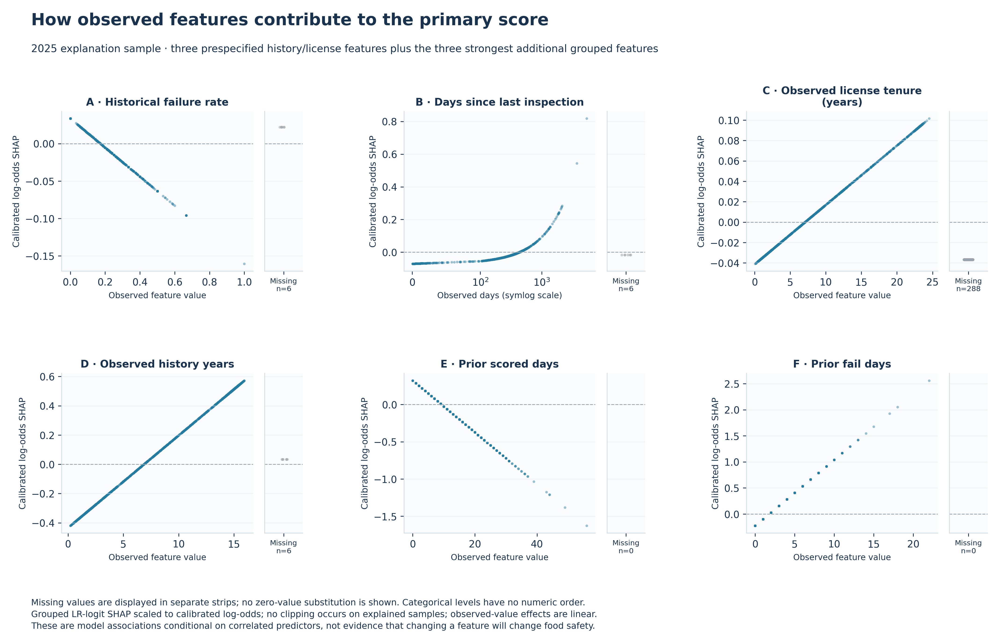

依赖图是 LR 加性评分结构在样本上的展现，不是发现了复杂非线性阈值；数值观测点统一为蓝色，缺失值另列灰色展示。全局 Summary 中，分类与缺失值使用灰色，连续变量的红蓝颜色按各自分位数缩放，不能跨字段比较颜色的绝对大小。

### 8.3 相关性与组内抵消：为什么不能机械累加单项重要性

训练期成对完整记录中，`observed_history_years` 与 `prior_scored_days` 的 Pearson 相关约 **0.811**，`license_term_elapsed_days` 与 `days_since_license_issue` 约 **0.958**。这些是共现关系，不足以确定哪个变量导致某个系数方向。[训练期相关系数](metrics/feature_correlations.csv)

在同一 1,500 条全局样本中：

| 特征组 | 逐字段平均绝对贡献之和 | 先有符号求和后的平均绝对组贡献 | 组内抵消率 |
|---|---:|---:|---:|
| 检查历史 | 1.4964 | 0.2719 | 81.83% |
| 许可历史 | 0.7639 | 0.0709 | 90.72% |

抵消率定义为 `1−mean(abs(组内Σφ))/Σmean(abs(φ))`。其意义是同一样本上正负项大量相抵，而不是“81.83% 的历史特征无用”或“许可信息没有增益”。要评价增加／删除一组特征的预测价值，需要另行预先设计消融实验；本次没有用这些归因汇总冒充消融结果。[特征组汇总](metrics/shap_feature_groups.csv)、[定义与解释边界](metrics/feature_context.json)

## 9. 误判分析：容量遗漏、概率错误与现场根因分开

### 9.1 操作点决定 FP／FN 的含义

本节主分析以**年度 pooled Top10% 优先容量**为操作点：837 个槽位，2025 回溯边界分数约 0.32717，无边界同分。FP 指 Non-Fail 占用优先槽位，FN 指 Fail 未进入优先槽位。它们是相对该优先规则的错误，不等于商户被正式告警或漏掉所有后续常规检查。

| 操作点 | TP | FP | FN | TN | 分配槽位 |
|---|---:|---:|---:|---:|---:|
| 年度 Top10%（本节主口径） | 303 | 534 | 1,583 | 5,943 | 837 |
| 单独诊断：概率 ≥0.5 | 18 | 25 | 1,868 | 6,452 | 43 |

默认 0.5 阈值只分配 43 个槽位，占 0.51%，显然不能代替固定稽查容量政策。另一方面，0.32717 是 2025 全年分数产生后的边界，不能预先当作未来年份固定阈值。[完整错误定义](metrics/error_analysis.json)

### 9.2 四类群体画像

| 群体 | 数量 | 平均预测概率 | 平均历史失败日数 | 最近历史结果为 Pass | 从无历史失败日 | 许可历史可见 |
|---|---:|---:|---:|---:|---:|---:|
| TP | 303 | 39.10% | 6.29 | 53.80% | 2.64% | 85.81% |
| FP | 534 | 38.27% | 6.05 | 55.43% | 4.49% | 83.71% |
| FN | 1,583 | 23.03% | 2.11 | 68.86% | 25.33% | 79.91% |
| TN | 5,943 | 20.78% | 1.92 | 74.81% | 28.76% | 78.76% |

TP 与 FP 的平均风险及历史失败次数接近，说明历史高风险证据能够帮助排序，但不能准确判断每一次现场是否失败。FP 中 **34.83% 实际为 Pass w/ Conditions**，表明当前 Non-Fail 标签内部仍存在运营上有区别的结果；这不应被事后改成正类以美化指标，但应在解释优先资源是否“浪费”时保留语义。[错误群体汇总](metrics/error_group_summary.csv)

FN 中 68.86% 最近历史结果为 Pass，25.33% 从未出现可见失败日，提示依靠历史坏记录很难完整覆盖新出现的问题。与此同时，FN 的冷启动比例只有 **0.57%**，许可可见率仍为 79.91%；因此不能把大多数遗漏简单归因于没有数据。可能的记录不完备、经营实践变化、检查员差异与未观测隐患，无法仅凭这些聚合和 SHAP 分辨，不能写成已经证实的现场根因。

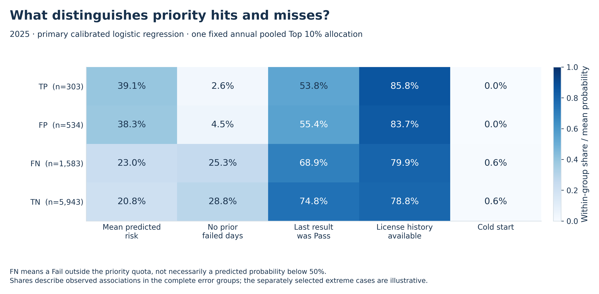

### 9.3 子组覆盖：同一全局规则下的分配差异

| 历史信息子组 | 目标数 | Fail 数 | Fail 率 | 获得全局 Top10 槽位的组内比例 | 捕获该组 Fail 的比例 |
|---|---:|---:|---:|---:|---:|
| 无可见许可历史 | 1,710 | 361 | 21.11% | 7.60% | 11.91% |
| 有可见许可历史 | 6,653 | 1,525 | 22.92% | 10.63% | 17.05% |
| 记录许可期限已过 | 470 | 129 | 27.45% | 30.85% | 44.96% |
| 在记录许可期限内 | 6,182 | 1,396 | 22.58% | 9.07% | 14.47% |
| 最近历史类型为 Restaurant | 5,950 | 1,382 | 23.23% | 8.72% | 14.40% |
| 检查历史冷启动 | 44 | 9 | 20.45% | 0.00% | 0.00% |

这些是**同一全局容量规则的切片**，没有为每个子组重新取 Top10%，各行也不都是互斥分组。Restaurant 组仍有 1,183 次 Fail 未进入优先队列，说明不能只展示少数高命中组。无许可历史组的覆盖较低，值得在试点中监测，但不能从观察性分组直接推断歧视或其因果来源。

冷启动只有 44 个样本、9 次 Fail，按预设小样本条件被标记；0 捕获是这次队列的事实，不支持对未来冷启动商户下稳定结论。`End unknown` 仅 1 个目标，不在本表作比较排名。记录期限已过也不代表违法经营。[全部子组、样本量和小样本标记](metrics/error_subgroup_metrics.csv)

### 9.4 三个匿名局部案例

共保存 3 个 FP、3 个 FN、3 个 TP，九例属于九个不同实体。FP／TP 选高分极端例，FN 选低分极端例；它们帮助解释评分失配，不代表群体发生频率。公开文件只保留匿名编号、有限历史摘要和贡献，不含商户身份、地址、许可号或检查 ID。[九例轻量摘要](metrics/error_case_summary.csv)

**FP-01：预测 Fail 66.06%，实际 Pass。** 历史上 45 个已评分日中有 21 个失败日；`prior_fail_days` 的贡献为 +2.4333 log-odds，被 `prior_scored_days` 的 −1.2454 部分抵消，许可期限相关项又提高部分分数。最近历史结果虽为 Pass，较长失败历史仍将其排入高优先级。模型解释了历史记忆为何持续存在，不能断言商户是否已经整改或此次检查是否宽松。

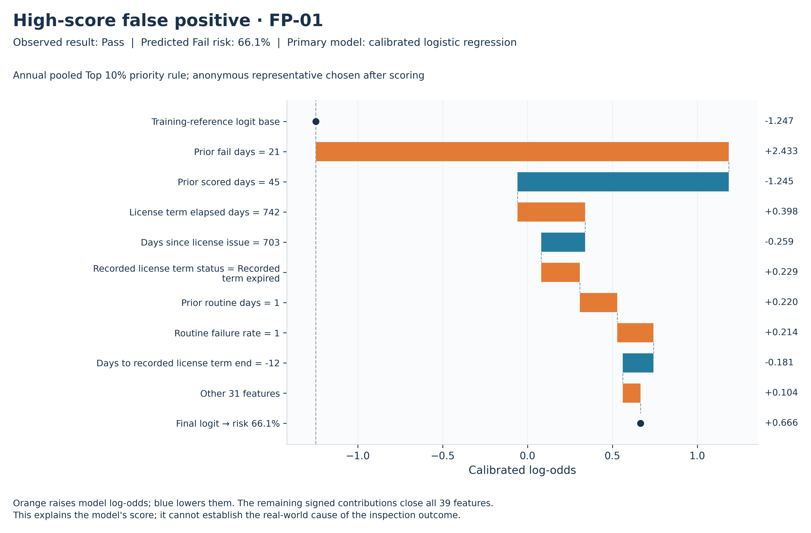

**FN-01：预测 Fail 6.80%，实际 Fail。** 具有 19 个已评分日、1 个历史失败日，最近历史结果为 Pass，没有匹配到可见许可历史。例行检查日数、已评分日数及许可类别项分别贡献 −0.4696、−0.3391、−0.2201 log-odds，使其落在低分端。这是“现有历史看起来相对平稳但本次失败”的评分案例，尚不能证明失败是新发生、数据延迟或其他具体因素造成。

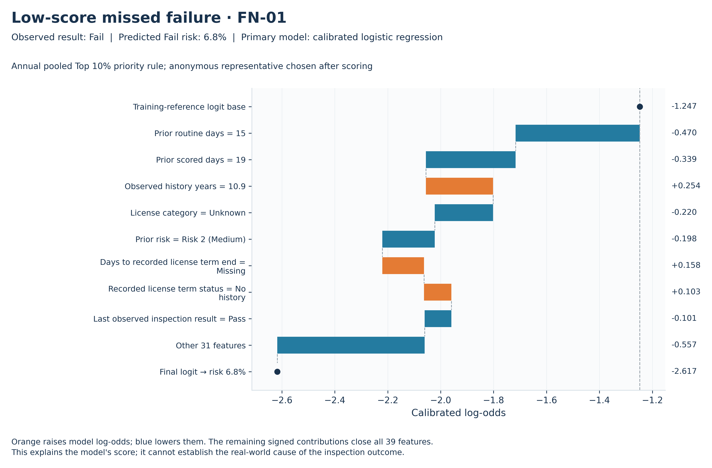

**TP-01：预测 Fail 71.56%，实际 Fail。** 37 个已评分日中有 18 个失败日；历史失败日与条件通过日贡献 +2.0537、+0.4368，已评分日数贡献 −0.9666。多项历史不良结果仍使风险处于高位，形成一次正确优先命中。它展示的是模型可以利用的证据组合，不能概括所有 Fail 的生成机制。

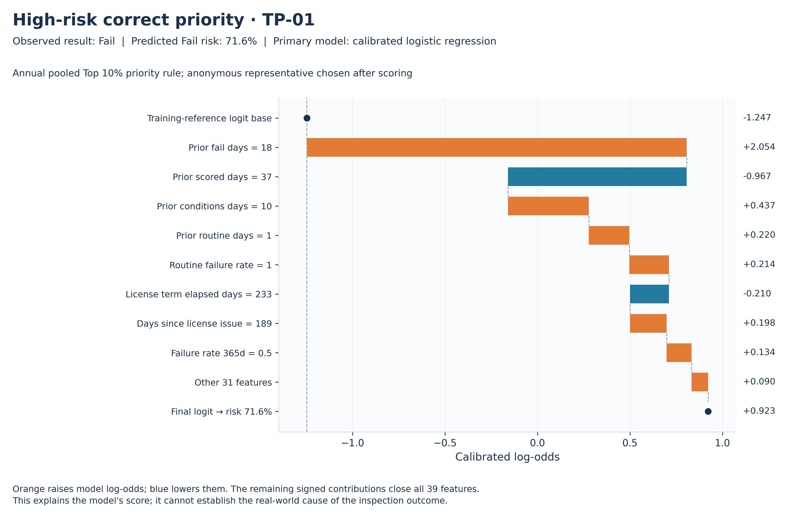

每张局部图展示绝对贡献最大的 8 个字段，并把其余 31 个字段**有符号求和**为 Others；最大 logit 闭合误差 8.88×10⁻¹⁶。图中橙色／蓝色表示增加／降低模型 log-odds，没有把贡献直接加到概率上。[局部解释核验](metrics/error_analysis.json)

## 10. 数据滞后敏感性：平均变化小，局部变化不可忽略

保持目标的检查 ID、日期、实体和标签完全一致，把默认 1 天历史滞后扩大至 7／30 天；重建可见历史后使用原模型、原预处理器和原 2024 校准器预测，**不重新训练、选参或校准**。这衡量固定评分系统面对信息延迟的敏感性，不是不同 lag 专用模型的性能竞赛。

| 主模型历史滞后 | 特征发生变化的目标比例 | 平均绝对概率变化 | 最大绝对概率变化 | AP | Brier | Top10 分配保留率 |
|---|---:|---:|---:|---:|---:|---:|
| 1 天 | 0.00% | 0.0000 个百分点 | 0.00 个百分点 | 0.314566 | 0.168513 | 100.00% |
| 7 天 | 1.84% | 0.0314 个百分点 | 12.55 个百分点 | 0.314235 | 0.168556 | 98.92% |
| 30 天 | 9.21% | 0.1605 个百分点 | 12.55 个百分点 | 0.313942 | 0.168594 | 96.18% |

7 天实验中超过 95% 的样本评分不变，不能据此忽略少数变化明显的商户；30 天实验下 9.21% 的目标特征变化，且 Top10 的具体优先对象也有调整。LightGBM 的 30 天 AP 从 0.321491 降至 0.319257，最大单条概率变化达 20.23 个百分点，同样说明总体排序指标不足以概括个体稳定性。[全部两模型×三滞后结果](metrics/lag_sensitivity.csv)

此处未计算敏感性差值置信区间，也未作显著性或因果结论。保持目标不变可以隔离“可见历史截断规则变化”这一计算因素，但无法还原地址回填、历史字段更正和真正的发布时间；较稳定的 AP 不能证明不存在历史公开时间泄露。[实验定义与限制](metrics/lag_sensitivity.json)

## 11. 面向 CDPH 的资源调度：已测收益与待验证策略

### 11.1 在同日候选集合内评估容量

逐日回测在每个实际检查日的观察记录内排序，容量为 `ceil(f×当天目标数)`，随机基准也按同日同容量计算。它避免把全年目标当成同时存在的队列，但仍没有包含当日所有可能合资格而未被检查的商户，故属于观察队列内收益。

| 名义每日容量 | 实际年度槽位 | 实际选择比例 | 模型捕获 Fail | 同日随机预期捕获 | 预期增量 | 相对随机 Lift | 全部 Fail 捕获率 |
|---|---:|---:|---:|---:|---:|---:|---:|
| Top5% | 539 | 6.45% | 201 | 122.09 | 78.91 | 1.646 | 10.66% |
| Top10% | 948 | 11.34% | 341 | 214.22 | 126.78 | 1.592 | 18.08% |
| Top20% | 1,777 | 21.25% | 587 | 400.93 | 186.07 | 1.464 | 31.12% |

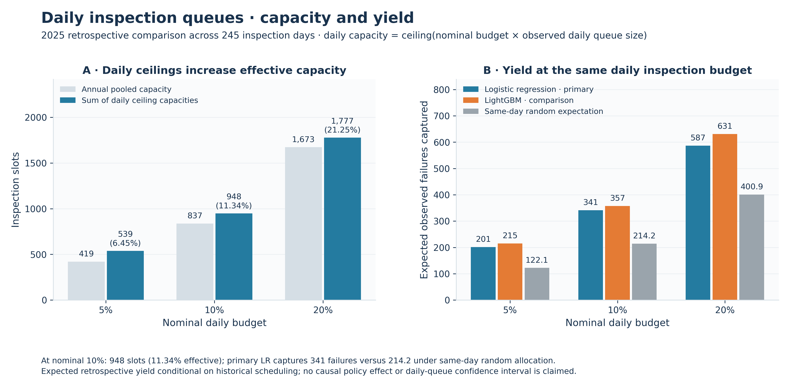

若以这批历史观察对象作容量比较，Top10%→Top20% 增加 829 个槽位、多覆盖 246 次 Fail，新增槽位命中率为 **29.67%**。总捕获率从 18.08% 升至 31.12%，但仍有大量 Fail 未在优先额度内。业务上应把模型用于**决定先查谁**，并保留常规覆盖与法定要求，不能把低分解释为免检依据。[逐日收益表](metrics/figure_daily_capacity_yield.csv)

### 11.2 建议试点的设计，尚未实施或验证

1. **先形成真实合资格队列。** 由 CDPH 结合到期规则、检查周期、地理路线和人员能力确定候选池及日期；仅对当时可见数据评分，保留全部候选，包括最终没有被检查的商户。这一步是从观察检查集转为真实调度验证所缺少的数据基础。
2. **用实际槽位而非固定概率阈值控制预算。** 当日有 B 个可调度槽位时，在合资格集合内按风险排序分配；结合人工业务约束记录每次调整。不要把历史 0.32717 阈值或默认 0.5 阈值永久固化。
3. **保留覆盖与随机探索。** 高分优先不能取消低分商户的常规检查要求。试点可在满足既有规则后，预先划出一部分可调度槽位对其余合资格商户随机抽取，记录抽样概率；具体占比应由容量、覆盖目标和试点统计设计确定。本报告没有用离线 Top-K 指标验证任何特定探索占比。
4. **先观察概率和队列质量，再评价政策效果。** 监测每期基础 Fail 率、Brier／LogLoss、实际槽位命中、合资格队列覆盖、等待时长、冷启动和许可缺失组的覆盖，以及人工改排原因。需等结果回传后评价校准漂移，而不是根据新样本即时反复改阈值。
5. **以预先定义的对照试点评估收益。** 在业务允许的合资格范围和时间区间内，比较模型辅助排班与既有排班，并记录容量、路线与检查员等约束。离线增量是提出试点的依据，不是试点结果；是否更早发现风险、是否改善公共卫生，必须另行验证。

以上是基于当前结果提出的部署建议，并非已经在 CDPH 上线或证实获得相同增益。模型可以提高有限优先槽位的期望命中，同时仍需要完整检查制度承担覆盖责任。

## 12. 与政府项目及 Hindsight 论文的关系

[Chicago/food-inspections-evaluation](https://github.com/Chicago/food-inspections-evaluation) 是本研究的重要问题来源。官方项目预测旧制度下的 **critical violations**，并利用 2014 年两个月的检查记录模拟不同排班；本项目预测 2025 年 `Fail`，使用不同标签、时期、输入与容量定义。其“提前约七天”或“首半程发现 69%”不能直接作为本项目结果，也不能用本项目 AP／Top10% 去宣称超越该数字。[官方评估介绍](https://chicago.github.io/food-inspections-evaluation/)

Kannan、Shapiro 与 Bilgic 的 *Hindsight Analysis of the Chicago Food Inspection Forecasting Model*（AAAI FSS-19，2019）指出，历史重排假设换一天检查仍会得到同一结果，而该假设可能受季节和其他因素影响；检查员差异也会影响风险记录，命中率提高不能直接等同公共卫生改善。本报告因此把观察样本排序、模型解释与真实调度因果效果分开，并避免将检查员或当前结果作为输入。[论文全文](https://arxiv.org/html/1910.04906v1)、[论文元数据](https://arxiv.org/abs/1910.04906)

## 13. 交付物与最终复核状态

本报告以各步骤已保存的汇总产物为证据，正文嵌入 11 张高清图。关键结果可按以下链条核对：

| 内容 | 可核对的交付物 |
|---|---|
| 来源、目标、切分、匹配、缺失与漂移 | [data_summary.json](metrics/data_summary.json)、[annual_drift.csv](metrics/annual_drift.csv) |
| 逐模型真实指标 | [LR](metrics/logistic_regression_metrics.json)、[LightGBM](metrics/lightgbm_metrics.json)、[基率](metrics/prevalence_metrics.json) |
| 固定选择、统一比较与差值不确定性 | [model_selection.json](metrics/model_selection.json)、[model_comparison.csv](metrics/model_comparison.csv)、[paired_model_differences.json](metrics/paired_model_differences.json) |
| 校准与全局解释 | [calibration_summary.json](metrics/calibration_summary.json)、[shap_summary.json](metrics/shap_summary.json)、[shap_global_importance.csv](metrics/shap_global_importance.csv) |
| 误判、匿名案例与子组 | [error_analysis.json](metrics/error_analysis.json)、[error_case_summary.csv](metrics/error_case_summary.csv)、[error_subgroup_metrics.csv](metrics/error_subgroup_metrics.csv) |
| 信息滞后及相关归因 | [lag_sensitivity.json](metrics/lag_sensitivity.json)、[feature_context.json](metrics/feature_context.json) |
| 容量与业务收益 | [年度 Top-K](metrics/figure_topk_performance.csv)、[逐日容量](metrics/figure_daily_capacity_yield.csv) |

当前研究结论建立在已完成的全量数据处理、模型训练、独立校准、留出评估及解释数值闭合上。**最终全量 pytest、README 一键复现说明、图片链接和 Git 追踪检查将在 Step 10 汇总；本节由最终 QA 结果更新。**

### 外部一手参考

1. City of Chicago：[Food Inspections，4ijn-s7e5](https://data.cityofchicago.org/Health-Human-Services/Food-Inspections/4ijn-s7e5)。
2. City of Chicago：[Business Licenses，r5kz-chrr](https://data.cityofchicago.org/Community-Economic-Development/Business-Licenses/r5kz-chrr)。
3. City of Chicago：[food-inspections-evaluation 源码](https://github.com/Chicago/food-inspections-evaluation)与[官方评估介绍](https://chicago.github.io/food-inspections-evaluation/)。
4. Kannan, V., Shapiro, M. A., & Bilgic, M. (2019). [Hindsight Analysis of the Chicago Food Inspection Forecasting Model](https://arxiv.org/abs/1910.04906). AAAI FSS-19: Artificial Intelligence in Government and Public Sector。
